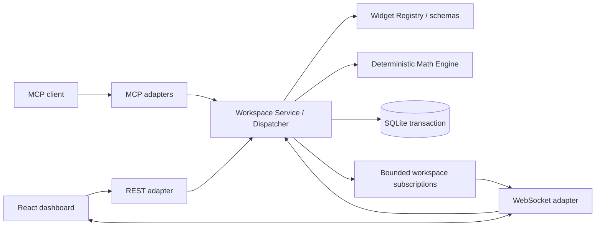
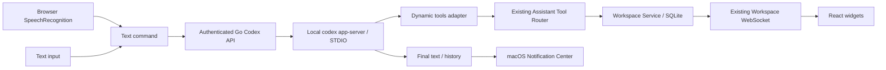

# Архитектура Forma

Один Go-процесс содержит HTTP, MCP STDIO/Streamable HTTP, WebSocket hub, сервис команд и SQLite. React/TypeScript/Vite/Tailwind frontend встраивается через `go:embed`. Компоненты диалогов используют Radix UI. Работа не требует облака.



## Структура

```text
cmd/server/main.go                 конфигурация, lifecycle, stderr logging
internal/mathengine/               генерация, рациональная проверка, тесты
internal/workspace/
  model.go                         State, Widget, Tab, Event
  schema.go                        используемое подмножество JSON Schema
  registry.go                      схемы и семантическая проверка виджетов
  tools.go                         единый каталог 28 команд
  service.go                       Workspace Manager и Event Dispatcher
  storage.go                       CGO SQLite adapter, транзакции
  migrations/001_init.sql           встроенные версионные миграции
internal/transport/
  mcp.go                           JSON-RPC, STDIO, Streamable HTTP
  http.go                          REST, auth, Origin/Host, SPA assets
  websocket.go                     RFC6455 framing, heartbeat, commands
web/
  embed.go                         встроенные production-ресурсы
  src/store.ts                     внешнее хранилище React и reconnect
  src/types.ts                     discriminated union типов виджетов
  src/App.tsx                      оболочка, навигация, создание, вкладки
  src/Widgets.tsx                   типизированные интерактивные карточки
  src/MathFormula.tsx               безопасный MathML для LaTeX генератора
  src/Chart.tsx                     lazy SVG line/bar/pie/scatter
  src/Markdown.tsx                  инертный безопасный Markdown subset
  src/CodeBlock.tsx                 lazy лексическая подсветка
  src/styles.css                   responsive, темы, reduced motion
scripts/                           dev launcher, независимые MCP/Codex smoke
  ui-fixture-browser.js            UI-тест для Playwright MCP с fixtures
e2e/workspace.spec.ts              полный серверный Playwright E2E
```

## Поток команды и атомарность

1. Адаптер ограничивает размер, проверяет аутентификацию и декодирует конверт.
2. `Service.Execute(ctx, name, JSON)` выбирает определение инструмента и проверяет схему. Реестр проверяет config по типу, ширину строк таблицы, значения pie, лимиты.
3. Под mutex сервиса создаётся независимая копия текущего состояния. Команда работает с копией; ошибка не затрагивает кеш/БД/подписки.
4. Математика вычисляется без AI, с `math/big.Rat`. Приватные ожидаемые ответы сохраняются в полном состоянии.
5. Версия увеличивается один раз. Из публичного снимка удаляются expected и нераскрытые steps.
6. `Store.Save` сохраняет состояние и событие в одной SQLite-транзакции `BEGIN IMMEDIATE`. В той же транзакции обрезается история до 100 последних событий.
7. Только после COMMIT кеш заменяется новой версией, событие передаётся подписчикам. MCP/REST возвращают структурированный результат.

Сбой записи или отмена контекста до COMMIT откатывает транзакцию. Подтверждённая запись может сохраниться, даже если клиент потерял соединение до получения ответа: это стандартное свойство мутаций без idempotency key. Повтор команды создания после такого сбоя может создать ещё один виджет; идентификаторы команд не используются для дедупликации мутаций. Клиент должен сначала перечитать состояние.

## Конкурентность

Эксклюзивная файловая блокировка базы не допускает запуск двух процессов с разными кешами на одном data-dir. Один mutex сериализует бизнес-мутации и атомарную регистрацию подписки со снимком. SQLite использует один FULLMUTEX connection и отдельный mutex. Порядок захвата: service → store; обратного вызова из store нет. Это осознанное упрощение для локального приложения с лимитом 50 пространств; горизонтальное масштабирование потребует другого storage/cache-контракта.

В текущей реализации JSON-документ workspace содержит вкладки, настройки, виджеты, приватные задачи и попытки. Нормализация в отдельные SQL-таблицы не нужна при выбранном размере состояния и атомарных снимках. Таблица событий хранит публичный audit trail. Миграции применяются в порядке имени SQL-файлов и фиксируют версию транзакционно.

## Realtime-контракт

```json
{
  "type":"widget.created",
  "workspace_id":"default",
  "widget_id":"opaque-id",
  "version":12,
  "payload":{"id":"default","version":12,"widgets":[],"tabs":[]}
}
```

`payload` содержит **полный публичный State**, а не только изменённую карточку. Это упрощает восстановление, UI-обработку математических попыток и удалений. Монотонная версия в пределах workspace позволяет игнорировать дубликаты и устаревшие события. Пропуск промежуточного события безопасен, потому что следующий снимок полон.

Подписка `Subscribe` и начальный снимок выполняются под одним mutex; между чтением и регистрацией не теряются изменения. Браузер принимает только события выбранного пространства. После reconnect обновляет HttpOnly-сессию, перечитывает список пространств и получает `state.snapshot`. При удалении выбранного пространства переключается на default.

У каждого подключения очередь 32 события. Заполненная очередь закрывается; клиент получает актуальный снимок при новом подключении. Запись сокета ограничена 5 секундами. Ping каждые 20 секунд, read deadline 60 секунд обновляется Pong. Текстовые сообщения ограничены 1 MiB; поддерживаются masked frames, fragmentation и контрольные кадры. Shutdown закрывает hijacked-сокеты и дожидается reader goroutine.

Команда от WebSocket: `{"id":"correlation-id","tool":"math_check_answer","arguments":{...}}`. Workspace закреплён за соединением, подмена ID отклоняется. Ответ `command.result`/`command.error` сопоставляется по id; изменения отдельно приходят в обычном event stream. Встроенный UI отправляет команды REST, а принимает синхронизацию через WebSocket.

## Безопасность и lifecycle

Default listen — IPv4 loopback. HTTP MCP требует отдельный Bearer; браузерная сессия выдаётся только на проверенном локальном Host/Origin. Пустой Origin допускается для HTTP CLI-клиентов, WebSocket требует Origin. Команды REST требуют JSON и `X-Workspace-Request`. Нет permissive CORS. Все пространства принадлежат одному локальному владельцу: глобальная auth не является многопользовательским ACL.

Не запускается пользовательский JS, HTML, LaTeX-макрос или исходный код. Markdown не использует HTML parser или `dangerouslySetInnerHTML`. Ответы математики остаются на сервере до проверки/раскрытия. Секреты не включены в structured logs.

`signal.NotifyContext` обрабатывает SIGINT/SIGTERM; STDIO EOF также останавливает процесс. HTTP shutdown имеет таймаут 5 секунд. Браузерные сокеты закрываются явно, затем останавливается сервис и закрывается SQLite. Контексты передаются через адаптеры; HTTP-команды ограничены 15 секундами. Ожидание SQLite lock ограничено 5 секундами; CGO-вызов не прерывается мгновенно при отмене контекста, но отмена проверяется до записи и COMMIT.

## Расширение

Новый виджет: добавить серверную схему и семантическую проверку в Registry, вариант discriminated union в `types.ts`, компонент и ветку renderer в `Widgets.tsx`; общие transport/storage/realtime не меняются. Новый инструмент регистрируется в каталоге Tools и реализуется в сервисном слое, после чего автоматически доступен REST и MCP.

Voice/Realtime теперь реализован как отдельный command producer; агентные исполнители и визуализация алгоритмов могут использовать тот же контракт. Они должны вызывать тот же сервис и соблюдать contexts/limits. Редактор/терминал потребуют отдельной модели прав и изоляции выполнения; текущий безопасный CodeWidget не должен превращаться в eval. Для нескольких пользователей понадобятся principal в context, workspace ACL до Execute/Subscribe и отдельные credentials. Для нескольких процессов — транзакционный version CAS и межпроцессный event bus; текущий кеш рассчитан на один процесс на базу.

## Локальный Codex и голосовой ввод



`internal/codexbridge` owns JSON-RPC process lifecycle, initialization with experimentalApi, account/read, thread/start/resume, turn/start/interrupt and ordered streaming notifications. The installed Codex owns authentication, model selection and network model calls. Go neither reads Codex auth tokens nor uses an OpenAI API key. OPENAI_API_KEY is filtered from the child environment; CODEX_HOME and user config are preserved. Per-installation runtime SQLite/log paths are passed as process config overrides. Logs from the subprocess are not copied into application logs.

One thread belongs to each workspace. Thread IDs and request receipts use the existing assistant_records table. One turn per workspace, up to four loaded active processes, no turn deadline. Inactive process eviction preserves the stored thread ID. Restarts resume the dedicated thread. Model deltas update bounded polling state; ordered item/completed then turn/completed prevents truncated final messages. Completion saves history and then queues the macOS message. SQLite reservation prevents retries with a reused request ID. An interrupted turn closes the process to avoid late events contaminating the next turn.

Dynamic tool specs are adapted from the same 26 functions used by the shared assistant router, using installed 0.167.1 protocol schemas: type=function, inputSchema, item/tool/call, contentItems=inputText. `Manager.LocalSession` creates a router session without a Realtime Provider. Tool schema validation, last-widget binding, workspace binding, at-most-once receipts and destructive nonce/version checks remain in that router. Process notifications are handled in order; server requests run separately so confirmations do not block JSON-RPC responses.

Codex command approval requests with a complete bounded preview require explicit UI decisions. File-change approvals are declined because the panel has no file-diff review UI. Unknown interactive requests receive protocol errors. Default sandbox is read-only; web_search=live is a thread-level config override subject to Codex/account policy. The user owns a separate Forma thread under their existing Codex account; the bridge does not inject text into unrelated Desktop chats.

Browser `speech.ts` replaces the Realtime audio path. Final recognition text and typed text use the same controller and Codex API. Interim transcription, missing support, permissions and recognition network errors are visible. Recognition starts only on a click, stops on end/confirmation/unmount; no Audio element or OpenAI RTCPeerConnection is created. Browser recognition may use a vendor network service, so offline voice is not guaranteed. macOS Dictation into the input is a fallback. The former Realtime modules remain as unused compatibility code/tests; production main initializes no Realtime Provider and returns 410 on its session-creation route.

### HTTP contracts

All routes inherit existing Host/Origin/cookie-or-Bearer/CSRF and body limits.

| Method | Path | Result |
|---|---|---|
| GET | `/api/assistant/status` | provider=codex, installed CLI availability |
| GET/PUT | `/api/assistant/workspaces/{id}` + `/settings` | existing history/settings |
| POST | `/api/assistant/codex/workspaces/{id}/turns` | request_id + text → 202 state |
| GET | `/api/assistant/codex/workspaces/{id}/state` | current streaming state/pending/final/error |
| POST | `/api/assistant/codex/workspaces/{id}/decision` | exact pending call_id + approve |
| POST | `/api/assistant/codex/workspaces/{id}/cancel` | cancel active turn |
| GET | `/api/desktop/status` | supported, queued/submitted/error |
| POST | `/api/desktop/notifications` or `/test` | queued native delivery |

The frontend polls only while a turn is active, restores an active turn after reload and fetches final history. Mutations to workspace widgets still arrive through the existing versioned WebSocket. No second widget/event implementation exists.

Turns use a cancellable context without a deadline. There is no application-imposed turn duration limit; manual cancellation and manager shutdown still stop the turn and release its child process. Startup, interrupt and confirmation operations retain their separate bounded timeouts.

### Managed media and extended registry

`workspace/media.go` owns MIME validation, bounded file ingestion, content-addressed storage and workspace metadata. Main enables `DATA_DIR/media` with cwd + the user's Codex generated_images root; optional extra roots come from WORKSPACE_MEDIA_IMPORT_ROOTS. Imports open relative to `os.OpenRoot`; symlink escape is rejected. Browser multipart streams and MCP local-path imports converge on the same storage and attachMedia helper, then use the existing widget_create service and event dispatcher.

Assets are copied before use; filenames are sanitized and match MIME, 25 MiB per file, 40 MP raster limit, 200 assets / 250 MiB per workspace. Blob names are SHA-256; metadata and workspace indexes live in the existing assistant_records table. File writes are synced and linked atomically without overwriting existing content. Asset metadata/state are separate: a failed widget creation can leave a stored unattached asset, and explicit garbage collection is not implemented. No user file is automatically removed when a widget disappears.

POST /api/media/{workspace} accepts one multipart file and optional attach=true/false. GET /api/media/{workspace}/{id} verifies metadata and workspace, opens under the media root, and uses ServeContent for native range requests. Both inherit auth/Origin/Host; uploads require X-Workspace-Request. PDF is attachment; nosniff and restrictive response CSP prevent active content. Registry media URLs accept only managed /api/media paths or public credential-free HTTPS, never file://, arbitrary path traversal or local-network URLs. Go never proxies a remote arbitrary URL.

Registry has 15 types. New gallery/audio/video/file share media URL validation. Checklist has unique bounded IDs and persists through widget_update; metric and progress remain typed display configurations. React media widgets offer an accessible image Dialog, native controls without autoplay, typed text and downloads. MediaUpload uses the browser file picker or drop, sequential multipart uploads and optional gallery assembly. No HTML/JS from AI is executed.

The dynamic-tool catalog is fingerprinted. Persisted threads resume only when their schema fingerprint matches; upgrades create a fresh thread with current tools, instructions and bounded previous context, while preserving old Codex rollouts. This is needed because App Server dynamicTools are established at thread creation.

### Voice endpoint timing

BrowserSpeech accumulates final AND interim text across short recognizer sessions. A final result never triggers immediate dispatch. Speech-start clears the send deadline; speech-end arms the configurable silence delay, default 4000 ms, range 2000–10000. End/no-speech restarts preserve a pending deadline instead of extending it indefinitely. The visible draft can be sent explicitly with flush; manual mic-off submits it, disposal/confirmation cancels it. Repeated/late results from a committed session do not duplicate a turn. No speech is dispatched while the recognizer reports active speech. The browser still owns ASR and may use a vendor service; offline ASR is not guaranteed.

Settings add speech_pause_ms with default migration for older JSON records. The existing SQLite schema already supports settings and media metadata, so no empty SQL migration is added. Controller queues up to three complete voice commands behind an active Codex turn. Workspace updates still use versioned WebSocket events.

### macOS adapter

`desktop.Manager` observes only committed notification-widget events and receives final Codex replies. Fixed AppleScript with separate argv prevents text-to-code interpolation. Two bounded workers own events/delivery; osascript has a four-second timeout. Queue 32, 30 notifications/min, last 2000 SQLite receipts, at-most-once with possible loss after a crash. Shutdown cancels and joins workers. macOS controls permissions/Focus/style; submitted is not a banner-visibility acknowledgment. The one-binary distribution has no separate signed app icon.
