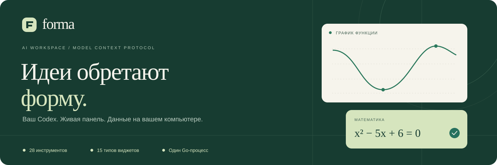
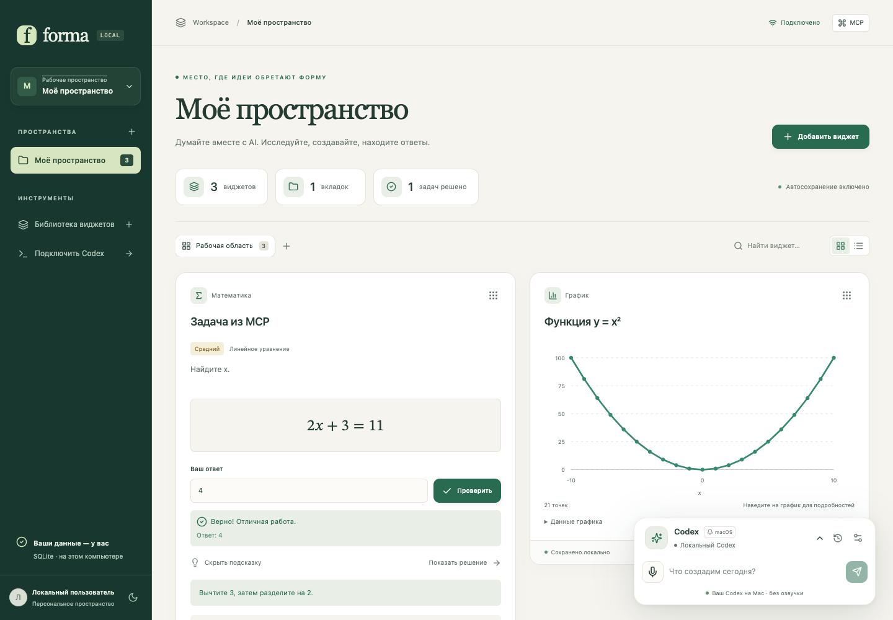
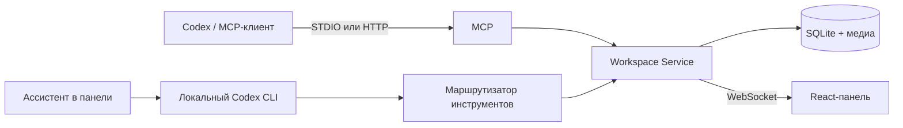

<p align="center">
  
</p>

<p align="center">
  <a href="https://github.com/mikail-tommard/ai-workspace/actions/workflows/ci.yml"></a>
  
  
  
  
</p>

<h1 align="center">Forma · AI Workspace</h1>

<p align="center">
  <strong>Превращайте разговор с Codex в интерактивное рабочее пространство.</strong><br>
  Задачи, графики, изображения и документы — на одной живой панели.<br>
  Локальный MCP-сервер. Один Go-процесс. Ваши данные на вашем компьютере.
</p>

<p align="center">
  <a href="#быстрый-старт"><strong>Установить</strong></a> ·
  <a href="INSTALL_CODEX.md">Подключить Codex</a> ·
  <a href="MCP_TOOLS.md">28 MCP-инструментов</a> ·
  <a href="ARCHITECTURE.md">Архитектура</a> ·
  <a href="TESTING.md">Проверки</a>
</p>

---

> «Создай математическую задачу средней сложности и покажи её на панели».
>
> Codex вызывает инструмент → Forma сохраняет задачу → интерактивная карточка появляется в браузере без перезагрузки.

<p align="center">
  
  <br><sub>Настоящий интерфейс с демонстрационными данными. Светлая тема; также доступна тёмная.</sub>
</p>

## Что можно делать

| Учиться и исследовать | Создавать и организовывать |
| :--- | :--- |
| Решать задачи с точной проверкой ответов | Добавлять локальные фото, галереи и PDF |
| Получать подсказки и пошаговые решения | Смотреть видео и слушать аудиофайлы |
| Строить line, bar, pie и scatter-графики | Собирать Markdown, код и таблицы |
| Проходить интерактивные математические тесты | Вести чек-листы, показатели и прогресс |

**15 типов виджетов · 28 MCP-инструментов · несколько пространств и вкладок.**

Все изменения синхронизируются через WebSocket и сохраняются в SQLite. После перезапуска панель восстанавливает состояние. Frontend встроен в бинарник через `go:embed`.

## Быстрый старт

Нужны **Go 1.26.5+**, **Node.js 22.12+**, npm, make, C-компилятор с SQLite и установленный **Codex CLI**. На macOS установите Command Line Tools; на Debian/Ubuntu — `build-essential libsqlite3-dev`. [Полные требования →](INSTALL_CODEX.md#требования)

```bash
git clone https://github.com/mikail-tommard/ai-workspace.git
cd ai-workspace
bash scripts/install.sh
```

Установщик соберёт приложение и зарегистрирует MCP в вашем Codex. Перезапустите Codex и откройте **[localhost:8080](http://localhost:8080)** — сервер и панель запускаются автоматически вместе с MCP.

Затем попросите Codex:

```text
Создай математическую задачу средней сложности и покажи на панели.
```

<details>
<summary><strong>Запустить панель отдельно, без регистрации MCP</strong></summary>

```bash
npm ci
make build
./ai-workspace
```

Откройте http://localhost:8080. Для подключения уже работающего сервера используйте [Streamable HTTP](docs/REFERENCE.md#streamable-http). Не запускайте два экземпляра на одном порту.

</details>

<details>
<summary><strong>Подключить собранное приложение вручную</strong></summary>

```bash
codex mcp add ai-workspace -- sh /absolute/path/ai-workspace/scripts/run-mcp.sh
codex mcp get ai-workspace
```

Папка проекта должна оставаться на месте. Данные launcher хранит отдельно: `~/Library/Application Support/ai-workspace` на macOS и `${XDG_DATA_HOME:-~/.local/share}/ai-workspace` на Linux. [Пути, перенос данных и другой порт →](INSTALL_CODEX.md#данные-и-настройки)

</details>

## Общайтесь, а панель будет меняться

| Вы говорите Codex | Forma показывает |
| :--- | :--- |
| «Создай квадратное уравнение» | Задачу с полем ответа, подсказкой и решением |
| «Сделай её сложнее» | Изменённую задачу в той же карточке |
| «Построй график синуса» | Интерактивный график |
| «Добавь эту локальную картинку» | Изображение через `media_import` |
| «Создай таблицу с планом» | Таблицу с поиском и сортировкой |
| «Добавь вкладку “Исследование”» | Новую вкладку рабочего пространства |

Внутри панели есть свой компактный ассистент: текстовые команды и голосовой ввод отправляются установленному Codex через `codex app-server`. Ответы показываются текстом; на macOS поддерживаются системные уведомления. Контекст последней задачи и результаты инструментов помогают продолжать диалог.

**Отдельный `OPENAI_API_KEY` не нужен.** Встроенный ассистент использует вход через `codex login`; обычный MCP работает и с другими совместимыми клиентами. Микрофон включается только по нажатию, пауза перед отправкой настраивается от 2 до 10 секунд.

## Как это устроено



MCP, REST и ассистент используют общий сервисный слой: одинаковые схемы, проверки и события. Виджеты строго типизированы; полученные от AI HTML и JavaScript не исполняются. Сервер слушает только loopback, HTTP MCP защищён Bearer-токеном, браузерные запросы — проверками Host/Origin и сессией. [Подробнее об устройстве и границах доступа →](ARCHITECTURE.md)

## Документация

| Документ | Что внутри |
| :--- | :--- |
| [Установка в Codex](INSTALL_CODEX.md) | Установка на другом компьютере, перенос данных, обновление |
| [Справочник запуска](docs/REFERENCE.md) | Флаги, окружение, оба транспорта, ассистент и ограничения |
| [MCP Tools](MCP_TOOLS.md) | Все 28 инструментов, параметры и схемы виджетов |
| [Архитектура](ARCHITECTURE.md) | Сервисный слой, протоколы, хранение и расширение |
| [Тестирование](TESTING.md) | Команды, фактические результаты, mocks и живые проверки |
| [Пример окружения](.env.example) | Настройки без секретов; `.env` автоматически не загружается |

## Разработка

```bash
make dev          # Go + Vite HMR
make build        # frontend → один Go-бинарник
make test         # Go, race detector, TypeScript, frontend unit tests
make lint         # go vet + ESLint
npm run test:mcp  # реальные STDIO-вызовы официальным MCP SDK
make test-http    # Streamable HTTP через настоящий Go handler и IPC
make e2e          # Playwright; требуется доступный браузер и loopback
```

Локально проверены production-сборка, Go unit/integration/race-тесты, lint, 18 frontend-тестов и 28 инструментов через независимый MCP SDK. Настоящий Codex импортировал локальное изображение; его отображение проверено на запущенном сервере. Браузерные fixture-сценарии используют обозначенные mocks. [Полный отчёт →](TESTING.md)

## Что стоит знать

- **Локальная панель — не полностью офлайн AI.** Модели Codex и браузерное распознавание речи могут использовать сеть. Физический микрофон отдельно не проверен.
- **Один локальный владелец.** Публичный доступ и многопользовательские роли не реализованы.
- **macOS и Linux.** Системные уведомления работают только на macOS; Windows/WSL2 и кросс-компиляция не проверены. Бинарнику нужна совместимая системная SQLite.
- **Пользовательские данные отдельно от Git.** База, токены и локальные вложения не входят в репозиторий. Для резервной копии остановите сервер и скопируйте весь каталог данных.
- **Без встроенного лимита времени команды.** Codex выполняет запрос до завершения, ручной отмены, разрыва соединения или остановки приложения; лимиты аккаунта Codex продолжают действовать.

---

<p align="center"><strong>Forma</strong><br><sub>Место, где идеи обретают форму.</sub></p>
